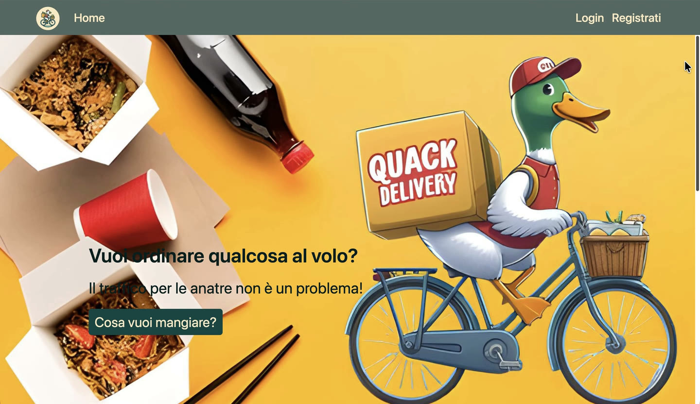

# DeliveBoo — backend

A learning project for ordering food for delivery, from choosing dishes to managing orders in the restaurant dashboard. Built in 2024 by a team of five in about a month, as the final project of Boolean’s Full Stack Web Developer programme.

**[Watch the video demo](https://massimoperuga.dev/en/demo/deliveboo)** · [Project in my portfolio](https://massimoperuga.dev/en/formazione/boolean#deliveboo) · [Italiano](README.md)

[](https://massimoperuga.dev/en/demo/deliveboo)

This repository contains the **Laravel backend**, the APIs used by the frontend and the restaurant dashboard views. The video shows the complete application, including the customer frontend developed separately. The portfolio hosts the recording; the backend is not deployed as a publicly usable service.

## The project

We organised the work independently, with instructors from other classes acting as clients to simulate stakeholder discussions. The goal was to connect an ordering interface to a backend with relational data, a restaurant dashboard and test payments.

The [original assignment and exercise documentation](CONSEGNA.md), in Italian, is preserved in full so that the initial requirements can be compared with the implementation.

## My contribution

I handled task allocation, technical decisions and support for teammates, agreeing on choices with the group. On the backend, I implemented:

- **Orders:** storing delivery details and linking each order to its dishes and quantities through a many-to-many relationship.
- **Order views:** listing orders for the signed-in restaurant and displaying their dishes and quantities in a detail view.
- **Payments:** integrating Braintree in sandbox, from generating the client token to submitting the transaction and returning its result.

## Backend features

- Restaurant owner registration and sign-in, with restaurant profiles and cuisine types.
- Creating, editing and deleting dishes, with images and availability.
- APIs for retrieving restaurants, menus and cuisine types, and recording orders.
- A restaurant dashboard for viewing received orders.
- Payment token and checkout endpoints using Braintree sandbox.

## Stack and organisation

| Area | Technologies |
| --- | --- |
| Backend | PHP, Laravel 10 |
| Data | MySQL, Eloquent, migrations and seeders |
| Restaurant dashboard | Blade, Bootstrap 5, Sass, Vite |
| Authentication | Laravel Breeze |
| Test payments | Braintree PHP SDK, sandbox |

The data model connects users to restaurants, restaurants to dishes, and restaurants to cuisine types. The `dish_order` pivot table stores the quantity of each dish in an order.

Where to start in the code:

- [API controllers](app/Http/Controllers/Api): catalogue, order creation and checkout.
- [Dashboard controllers](app/Http/Controllers/Admin) and [Blade views](resources/views/admin): restaurant and dish management, and order views.
- [Models](app/Models) and [migrations](database/migrations): relationships and data structure.
- [API routes](routes/api.php) and [web routes](routes/web.php): application entry points.

## Running locally

These instructions cover the backend and its restaurant dashboard. The complete customer journey also requires the separate frontend shown in the video.

### Prerequisites

- PHP 8.1–8.3, with Laravel’s required extensions and the PDO MySQL driver. The historical lockfile includes dependencies that restrict later PHP versions.
- Composer 2.
- A Node.js version compatible with Vite 5 (`^18.0.0 || >=20.0.0`) and npm.
- A running MySQL server and a dedicated local database for the project.

### Installation and database

```sh
git clone https://github.com/MassimoPeruga/deliveBoo-backend.git
cd deliveBoo-backend
composer install
npm ci
cp .env.example .env
php artisan key:generate
```

In `.env`, set `APP_URL=http://localhost:8000`, `FILESYSTEM_DISK=public` and your local database values for `DB_CONNECTION=mysql`, `DB_HOST`, `DB_PORT`, `DB_DATABASE`, `DB_USERNAME` and `DB_PASSWORD`. The public disk makes uploaded images available through the `storage` link.

```sh
php artisan migrate
php artisan storage:link
php artisan db:seed --class=TypeSeeder
```

The main seeder is empty: `migrate --seed` alone does not load the sample data. `TypeSeeder` prepares the cuisine types needed to register a restaurant. Seeders empty their target tables; run them only against the dedicated local database.

### Starting the servers

Start the asset server in one terminal:

```sh
npm run dev
```

In another terminal, from the same directory:

```sh
php artisan serve --host=localhost --port=8000
```

Open [registration](http://localhost:8000/register) to create a restaurant or [sign-in](http://localhost:8000/login) to access the dashboard. This backend does not define a `/` route. The `localhost:8000` host also matches the image URLs constructed by the original APIs.

### Sandbox payments

To try the payment endpoints, add your own **Braintree sandbox** credentials to `.env` using these names:

```dotenv
MERCHANT_ID=
PUBLIC_KEY=
PRIVATE_KEY=
```

The [checkout controller](app/Http/Controllers/Api/CheckoutController.php) reads these variables; they are not included in `.env.example`. Keep their values in the local, Git-ignored file. You can explore the other backend features without configuring Braintree.

<details>
<summary>Additional sample data</summary>

On a newly created local database, after `TypeSeeder`, you can run these seeders in order:

```sh
php artisan db:seed --class=UserSeeder
php artisan db:seed --class=RestaurantSeeder
php artisan db:seed --class=DishSeeder
php artisan db:seed --class=OrderSeeder
```

These seeders replace data in the affected tables. Orders are generated with Faker; the initial image paths refer to storage files that are not included in the repository.

</details>

## Scope and limitations

The project preserves its 2024 learning implementation and dependencies. Payments use the sandbox exclusively, and the video recording documents the team’s result. The assignment describes the initial requirements; this presentation covers the features found in the backend without implying that every original requirement was completed.
