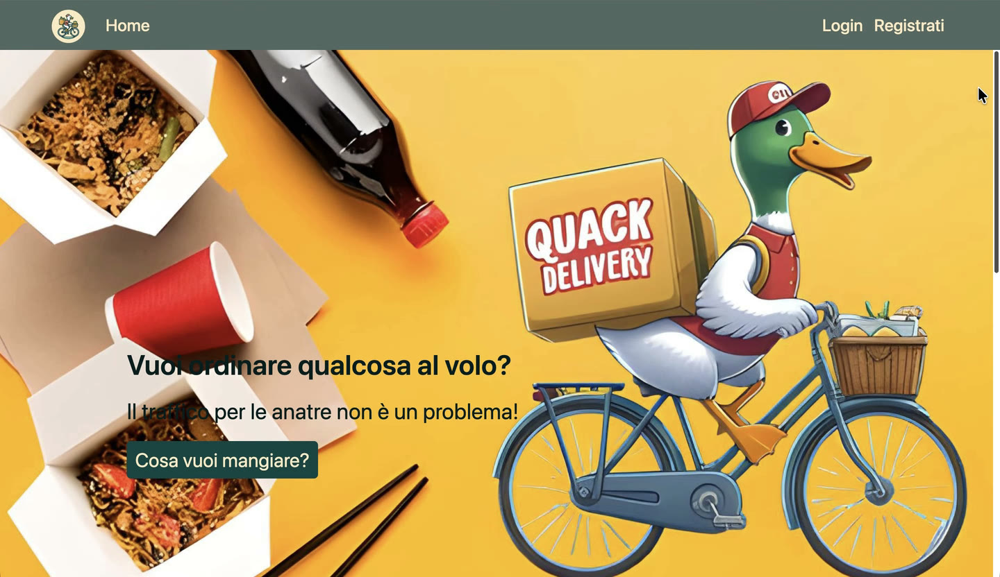

# DeliveBoo — backend

Applicazione didattica per ordinare cibo a domicilio, dalla scelta dei piatti alla gestione degli ordini nell’area ristoratore. Progetto finale del percorso Full Stack Web Developer di Boolean, sviluppato nel 2024 da un team di cinque persone in circa un mese.

**[Guarda la demo video](https://massimoperuga.dev/demo/deliveboo)** · [Il progetto nel portfolio](https://massimoperuga.dev/formazione/boolean#deliveboo) · [English](README.en.md)

[](https://massimoperuga.dev/demo/deliveboo)

Questa repository contiene il **backend Laravel**, le API per il frontend e le viste dell’area ristoratore. Il video mostra l’applicazione completa, compreso il frontend cliente sviluppato separatamente. Nel portfolio è disponibile la registrazione: il backend non è pubblicato come servizio utilizzabile online.

## Il progetto

Abbiamo organizzato il lavoro in autonomia, con docenti di altre classi nel ruolo di committenti per simulare il confronto con gli stakeholder. L’obiettivo era collegare un’interfaccia di ordinazione a un backend con dati relazionali, un’area riservata e pagamenti di prova.

La [consegna e documentazione originale dell’esercizio](CONSEGNA.md) è conservata integralmente, così da poter confrontare le richieste iniziali con il codice realizzato.

## Il mio contributo

Mi sono occupato della divisione dei compiti, delle decisioni tecniche e del supporto ai compagni, concordando le scelte con il gruppo. Sul backend ho implementato:

- **Ordini:** salvataggio dei dati di consegna e associazione ai piatti con le rispettive quantità, tramite una relazione molti-a-molti.
- **Consultazione:** elenco degli ordini del ristorante autenticato e vista di dettaglio con piatti e quantità.
- **Pagamenti:** integrazione Braintree in sandbox, dalla generazione del token per il client all’invio della transazione e alla restituzione dell’esito.

## Funzionalità del backend

- Registrazione e accesso dei ristoratori, con profilo del ristorante e tipologie di cucina.
- Inserimento, modifica ed eliminazione dei piatti, con immagini e disponibilità.
- API per consultare ristoranti, menu e tipologie e per registrare gli ordini.
- Area riservata per visualizzare gli ordini ricevuti.
- Endpoint per token di pagamento e checkout Braintree in ambiente sandbox.

## Stack e organizzazione

| Ambito | Tecnologie |
| --- | --- |
| Backend | PHP, Laravel 10 |
| Dati | MySQL, Eloquent, migration e seeder |
| Area ristoratore | Blade, Bootstrap 5, Sass, Vite |
| Autenticazione | Laravel Breeze |
| Pagamenti di prova | Braintree PHP SDK, sandbox |

Il modello collega utenti e ristoranti, ristoranti e piatti, ristoranti e tipologie. La tabella di associazione `dish_order` conserva la quantità di ogni piatto nell’ordine.

Per orientarsi nel codice:

- [Controller API](app/Http/Controllers/Api): catalogo, creazione degli ordini e checkout.
- [Controller dell’area riservata](app/Http/Controllers/Admin) e [viste Blade](resources/views/admin): gestione del ristorante, dei piatti e consultazione degli ordini.
- [Modelli](app/Models) e [migration](database/migrations): relazioni e struttura dei dati.
- [Route API](routes/api.php) e [route web](routes/web.php): punti d’ingresso dell’applicazione.

## Avvio locale

La configurazione seguente riguarda il backend e la sua area riservata. Per il percorso cliente completo serve anche il frontend separato mostrato nel video.

### Prerequisiti

- PHP 8.1–8.3, con le estensioni richieste da Laravel e il driver PDO MySQL. Il lockfile storico include dipendenze con limiti sulle versioni PHP successive.
- Composer 2.
- Node.js compatibile con Vite 5 (`^18.0.0 || >=20.0.0`) e npm.
- MySQL attivo e un database locale dedicato al progetto.

### Installazione e database

```sh
git clone https://github.com/MassimoPeruga/deliveBoo-backend.git
cd deliveBoo-backend
composer install
npm ci
cp .env.example .env
php artisan key:generate
```

Nel file `.env` imposta `APP_URL=http://localhost:8000`, `FILESYSTEM_DISK=public` e i valori `DB_CONNECTION=mysql`, `DB_HOST`, `DB_PORT`, `DB_DATABASE`, `DB_USERNAME` e `DB_PASSWORD` del database locale. La scelta del disco pubblico permette di servire le immagini caricate attraverso il collegamento `storage`.

```sh
php artisan migrate
php artisan storage:link
php artisan db:seed --class=TypeSeeder
```

Il seeder generale è vuoto: `migrate --seed` da solo non carica i dati dimostrativi. `TypeSeeder` prepara le tipologie necessarie alla registrazione di un ristorante. I seeder svuotano le tabelle interessate: eseguili soltanto sul database locale dedicato.

### Avvio dei server

In un terminale avvia gli asset:

```sh
npm run dev
```

In un secondo terminale, dalla stessa cartella:

```sh
php artisan serve --host=localhost --port=8000
```

Apri [la registrazione](http://localhost:8000/register) per creare un ristorante oppure [il login](http://localhost:8000/login) per accedere all’area riservata. La route `/` non è definita in questo backend. L’host `localhost:8000` corrisponde anche agli URL delle immagini costruiti dalle API originali.

### Pagamenti sandbox

Per provare gli endpoint di pagamento, aggiungi a `.env` le credenziali del tuo account **Braintree sandbox** con questi nomi:

```dotenv
MERCHANT_ID=
PUBLIC_KEY=
PRIVATE_KEY=
```

Queste variabili sono lette dal [controller di checkout](app/Http/Controllers/Api/CheckoutController.php) e non sono presenti nel modello `.env.example`. Mantieni i valori nel file locale, escluso da Git. Le altre funzionalità del backend possono essere esplorate senza configurare Braintree.

<details>
<summary>Dati dimostrativi aggiuntivi</summary>

Su un database locale appena creato, dopo `TypeSeeder`, puoi caricare nell’ordine:

```sh
php artisan db:seed --class=UserSeeder
php artisan db:seed --class=RestaurantSeeder
php artisan db:seed --class=DishSeeder
php artisan db:seed --class=OrderSeeder
```

Questi seeder sostituiscono i dati delle tabelle coinvolte. Gli ordini sono generati con Faker; le immagini dei dati iniziali fanno riferimento a file di storage che non sono inclusi nella repository.

</details>

## Ambito e limiti

Il progetto conserva l’implementazione didattica del 2024 e le relative dipendenze. I pagamenti usano esclusivamente la sandbox e la registrazione video documenta il risultato del lavoro in team. Le funzionalità elencate nella consegna rappresentano le richieste iniziali: questa presentazione descrive il perimetro riscontrabile nel backend, senza dare per realizzato ogni requisito del documento originale.
